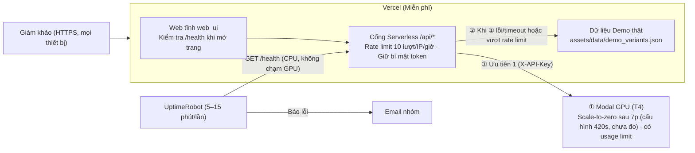

# Hướng dẫn Triển khai Có Failover — Tái Sinh Di Sản Số

> Với giao diện mới sau refactor, đọc `docs/DEPLOY_LIVE.md`. Các route `/api/generate`, `/api/status` và `/api/media` dưới đây mô tả gateway cũ; không dùng để deploy UI mới. Project Vercel chính thức đã chốt là `tai-sinh-di-san-so-ai`.

Tài liệu vận hành kiến trúc triển khai 2 lớp có khả năng tự động chuyển đổi (**Modal GPU → Demo Mode kết quả thật**) cho vòng Chung kết Cuộc thi Sáng tạo trẻ 2026.

> [!NOTE]
> **Về lớp Hugging Face Space**: Hugging Face hiện yêu cầu gói PRO trả phí để tạo Docker Space chạy phần cứng GPU. Do đó, hệ thống chính thức triển khai theo kiến trúc 2 lớp tối ưu chi phí: **Modal GPU (chính) → Demo Mode (kết quả thật $0)**. Toàn bộ mã nguồn đóng gói (`scripts/deploy/build_hf_space.py`) và logic kết nối HF Space vẫn được bảo toàn nguyên vẹn trong repo và có thể kích hoạt lại bất kỳ lúc nào bằng cách cấu hình biến môi trường trên Vercel.

---

## 1. Kiến trúc tổng quan



### Luồng xử lý một lần bấm "Tạo bộ 4 thiết kế" (gateway cũ)
1. **Mở trang**: `web_ui/assets/js/app.js` đọc `/api/live/health` để chọn chế độ giao diện mà không đánh thức Modal. Chỉ người vận hành có `WARMUP_KEY` mới được gọi `POST /api/warmup` với header `X-Warmup-Key` khi cần chuẩn bị trước buổi demo.
2. **Bấm tạo thiết kế**: Frontend gửi `POST /api/generate { "heritage_id": "..." }`.
3. **Kiểm tra Rate Limit**: Cổng Vercel kiểm tra giới hạn theo IP (`RATE_LIMIT_PER_HOUR=10`). Nếu vượt ngưỡng, cổng trả ngay kết quả từ `demo_variants.json` kèm thông báo và nhãn **"Kết quả đã sinh sẵn — không phải sinh trực tiếp"**.
4. **Gọi Modal GPU (Backend ①)**: Gửi `POST ${MODAL_URL}/generate` kèm header `X-API-Key: ${MODAL_KEY}` với timeout `MODAL_TIMEOUT_MS` (mặc định `25000` ms). Nếu nhận `job_id`, trả ngay cho frontend kèm `backend: "modal"`.
5. **Failover sang Demo Mode (Backend ②)**: Nếu Modal lỗi hoặc quá thời gian chờ (hoặc khi cả 2 backend GPU không khả dụng), cổng chuyển thẳng sang `backend: "demo"` cùng 4 thiết kế thật đã xuất từ Design Passport (`outputs/passports/`). *(Lưu ý: trên giao diện mới `/api/live/generate`, lỗi xác thực 401/403 từ Modal sẽ trả HTTP 503 báo lỗi xác thực thay vì chuyển sang Demo — xem `docs/DEPLOY_LIVE.md`.)*
6. **Polling & Proxy ảnh**: Frontend hỏi `GET /api/status?job_id=...&backend=...` mỗi `1.2` giây. Khi hoàn tất, mọi đường dẫn ảnh thiết kế được chuẩn hoá qua `/api/media?backend=...&file=...` để cổng Vercel gắn token ở phía server, tuyệt đối không lộ `MODAL_KEY` ra trình duyệt.

---

## 2. Biến môi trường từng thành phần

### 2.1. Trên Vercel (Project Settings → Environment Variables)

> **Project Vercel chính thức để nộp**: `tai-sinh-di-san-so-ai`, đã nối GitHub `quoczai22/tai-sinh-di-san-so-ai`, **Production Branch = `main`** ⇒ push lên `main` là tự deploy production.
>
> - **Cấu hình build**: **Root Directory = `web_ui`**, **Framework = Other**. Trước ngày 20/11/2026, mọi bản build của project này đều lỗi do Vercel nhận nhầm gốc repo là ứng dụng FastAPI (vì gốc có `requirements.txt` và `api/main.py`) và cố cài thư viện GPU (`pymeshlab` thất bại). Không đổi lại Root Directory = `web_ui`, nếu đổi thì build sẽ hỏng lại.
> - **Link công khai duy nhất để đưa giám khảo**: `https://tai-sinh-di-san-so-ai.vercel.app`. Các địa chỉ khác của project (có `-quoczai22s-projects`, có `-git-main-`, hoặc link từng bản deploy) bị Vercel Authentication chặn (yêu cầu đăng nhập Vercel) — không đưa cho giám khảo.
> - Project cũ `tai-sinh-di-san-so-design` (deploy tay bằng CLI) **không còn dùng để nộp**.
> - Mỗi lần thêm/sửa biến môi trường trên Vercel phải **Redeploy** thì biến mới có hiệu lực.

**Biến bắt buộc (Kiến trúc 2 lớp mặc định):**

| Biến môi trường | Giá trị mẫu / Mặc định | Mô tả |
|---|---|---|
| `MODAL_URL` | `https://<workspace>--tai-sinh-di-san-so-api-fastapi-app.modal.run` | URL endpoint của Modal sau khi chạy `modal deploy` |
| `MODAL_KEY` | `<chuỗi_bí_mật>` | Khóa bí mật khớp với `DH_API_KEY` trên Modal |
| `MODAL_TIMEOUT_MS` | `25000` | Thời gian chờ tối đa (ms) khi gọi Modal trước khi chuyển sang Demo. Đặt theo cold start đo thật |
| `RATE_LIMIT_PER_HOUR` | `10` | Số lượt sinh trực tiếp tối đa cho mỗi IP trong 1 giờ |
| `ALERT_DISCORD_WEBHOOK_URL` | `https://discord.com/api/webhooks/...` | (Khuyên dùng) Webhook Discord nhận cảnh báo tức thì khi Modal gặp lỗi/timeout |
| `ALERT_COOLDOWN_MIN` | `30` | Thời gian giãn cách tối thiểu giữa 2 lần gửi cảnh báo Discord (phút, mặc định 30) |

**Biến tuỳ chọn (Chỉ cần khi bật lại lớp dự phòng Hugging Face Space):**

| Biến môi trường | Giá trị mẫu / Mặc định | Mô tả |
|---|---|---|
| `HF_SPACE_URL` | `https://<user>-<space-name>.hf.space` | Direct URL của Hugging Face Docker Space dự phòng |
| `HF_TOKEN` | `hf_...` | Read token tài khoản Hugging Face, gửi trong `Authorization: Bearer` để vào Space riêng tư |
| `HF_API_KEY` | `<chuỗi_bí_mật>` (tuỳ chọn) | Khoá ứng dụng gửi trong `X-API-Key` tới Space, khớp `DH_API_KEY` của Space |
| `HF_TIMEOUT_MS` | `6000` | Thời gian chờ mỗi lần gọi HF Space |

### 2.2. Trên Modal (Secret `tai-sinh-di-san-secret`)

| Biến môi trường | Giá trị | Mô tả |
|---|---|---|
| `DH_API_KEY` | `<chuỗi_bí_mật>` | Khớp với `MODAL_KEY` trên Vercel; chặn truy cập trái phép vào GPU. **Chỉ** đặt trong secret Modal, không đặt trên Vercel |
| `DH_REQUIRE_API_KEY` | `1` (đã đặt sẵn) | Bật chế độ **fail-closed**: nếu `DH_API_KEY` trống thì `tsds/api/main.py` báo lỗi và **từ chối khởi động**, không mở GPU cho truy cập tự do. Đã đặt sẵn trong `Dockerfile` (`ENV`) và `modal_app.py`, không cần thêm vào secret. Chạy local không đặt biến này thì giữ hành vi cũ (không bắt khoá) |
| `HF_HOME` | `/cache/huggingface` | Model đã tải sẵn trong image (Dockerfile); `modal_app.py` tự đặt, không dùng Volume cho model |
| `DH_OUTPUT_DIR` | `/data/outputs` | Tự động gắn vào Modal Volume `tai-sinh-di-san-outputs` trong `modal_app.py` |

> **Tóm tắt 8 biến cố định**: trên **Vercel** đặt `MODAL_URL`, `MODAL_KEY`, `MODAL_TIMEOUT_MS` (25000), `RATE_LIMIT_PER_HOUR` (10), `ALERT_DISCORD_WEBHOOK_URL`, `ALERT_COOLDOWN_MIN` (30). Trên **Modal**: `DH_API_KEY` (secret `tai-sinh-di-san-secret`) và `DH_REQUIRE_API_KEY=1` (đã có sẵn trong image và `modal_app.py`).

### 2.3. Trên Hugging Face Space (Settings → Variables and secrets) — hiện KHÔNG dùng
> Lớp HF Space đã bỏ khỏi kiến trúc chính thức (xem ghi chú đầu tài liệu). Mục này chỉ giữ lại để tham khảo khi bật lại.

- **SDK**: `Docker` · **Visibility**: `Private` · **Hardware**: `Nvidia T4 small` · **Sleep time**: `15 minutes`.

| Loại | Tên biến | Giá trị | Mô tả |
|---|---|---|---|
| Secret | `DH_API_KEY` | `<khớp HF_API_KEY trên Vercel, hoặc MODAL_KEY nếu không đặt HF_API_KEY>` | Xác thực request từ cổng Vercel (header `X-API-Key`). **Không** đặt bằng `HF_TOKEN` |
| Variable | `HF_HOME` | `/cache/huggingface` | Thư mục chứa sẵn trọng số model đã tải trong `Dockerfile` |
| Variable | `DH_OUTPUT_DIR` | `/data/outputs` | Thư mục lưu ảnh biến thể và `audit.jsonl` |
| Variable | `PORT` | `7860` | Cổng mặc định của Hugging Face Docker Space |

---

## 3. Lệnh triển khai và kiểm thử từng bước

### 3.1. Xuất lại dữ liệu Demo của cổng từ Design Passport
```powershell
uv run python scripts/demo/export_gateway_demo.py
```

### 3.2. Kiểm thử tự động 8 tiêu chí nghiệm thu trên máy local (không tốn GPU)
```powershell
python tests/manual/test_acceptance_1_8.py
```

Hoặc chạy thủ công 3 cửa sổ terminal để trải nghiệm trực tiếp trên trình duyệt tại `http://127.0.0.1:3000`:
```powershell
# Terminal 1 — Mock Modal (cổng 8001)
$env:PORT="8001"; $env:DELAY="2"; $env:DH_API_KEY="dev_key"; python mock_backend.py

# Terminal 2 — Mock HF Space (cổng 8002)
$env:PORT="8002"; $env:DELAY="2"; $env:HF_TOKEN="dev_hf"; python mock_backend.py

# Terminal 3 — Cổng Vercel local (cổng 3000)
$env:MODAL_URL="http://127.0.0.1:8001"; $env:MODAL_KEY="dev_key"
$env:HF_SPACE_URL="http://127.0.0.1:8002"; $env:HF_TOKEN="dev_hf"
node scripts/deploy/dev_gateway.js
```

### 3.3. Triển khai Modal GPU (Backend ①)
```powershell
# 1. Đăng nhập Modal và tạo secret (chạy 1 lần)
pip install modal
modal setup
modal secret create tai-sinh-di-san-secret DH_API_KEY=<khoa_bi_mat_cua_nhom>

# 2. Chạy thử nghiệm dev
modal serve modal_app.py

# 3. Deploy chính thức (mặc định GPU T4)
modal deploy modal_app.py
```

### 3.4. Triển khai Hugging Face Space — hiện KHÔNG dùng (cần gói PRO)
1. Tạo Space mới trên Hugging Face: chọn **Docker** (Blank), chế độ **Private**, phần cứng **T4 small**, đặt **Sleep time = 15 phút**.
2. Đóng gói thư mục riêng cho Space rồi upload (không `git push` cả repo: Hugging Face từ chối file ảnh không qua LFS/Xet, và Space cần README có khai báo `sdk: docker`):
   ```powershell
   pip install -U huggingface_hub
   hf auth login
   python scripts/deploy/build_hf_space.py
   hf upload <user>/<space-name> dist/hf_space . --repo-type space
   ```
   CLI cũ dùng `huggingface-cli login` và `huggingface-cli upload ...` với cùng tham số.
3. Lấy **Direct URL** (`https://<user>-<space-name>.hf.space`) điền vào `HF_SPACE_URL` trên Vercel cùng `HF_TOKEN`.

---

## 4. Cách bật / tắt từng Backend và chuyển sang Cloudflare Tunnel

| Thao tác | Cách thực hiện |
|---|---|
| **Giả lập Modal sập (chuyển sang Demo)** | Chạy `modal app stop tai-sinh-di-san-so-api`. Lưu ý: **không** dùng cách đổi sai `MODAL_KEY` trên giao diện mới (`/api/live/generate`), vì lỗi 401/403 sẽ trả HTTP 503 báo lỗi xác thực thay vì chuyển sang Demo |
| **Bật lại Modal** | Chạy `modal deploy modal_app.py` |
| **Đổi Modal từ T4 sang L4 (buổi phản biện)** | `$env:MODAL_GPU="L4"; modal deploy modal_app.py` |
| **Ép chạy Demo Mode** | Dừng app Modal (`modal app stop tai-sinh-di-san-so-api`), hoặc xoá `MODAL_URL` trên Vercel rồi Redeploy |
| **Chuyển sang Laptop nhóm + Cloudflare Tunnel (dự phòng buổi phản biện)** | 1. Trên laptop có GPU NVIDIA của nhóm, chạy:<br>`$env:DH_API_KEY="<MODAL_KEY>"; python -m uvicorn tsds.api.main:app --host 127.0.0.1 --port 8000`<br>2. Mở terminal thứ 2 chạy:<br>`cloudflared tunnel --url http://localhost:8000`<br>3. Copy URL `https://*.trycloudflare.com` vừa sinh ra, dán vào biến `MODAL_URL` trên Vercel và Redeploy. |

---

## 5. Giám sát Uptime & Cảnh báo tức thì

Hệ thống kết hợp 2 kênh giám sát:
1. **UptimeRobot**: Ping định kỳ kiểm tra sống/chết của domain và CPU gateway (gửi Email cho 2–3 thành viên).
2. **Discord Webhook**: Gửi tin nhắn tức thì vào kênh chat của nhóm khi Modal gặp sự cố kỹ thuật và phải chuyển sang Demo mode.

### 5.1. Cấu hình giám sát UptimeRobot (Email nhóm)

1. Đăng nhập [UptimeRobot](https://uptimerobot.com/) → **Add New Monitor**:
   - **Monitor Type**: `HTTP(s)`
   - **Friendly Name**: `Tái Sinh Di Sản Số — Web & Gateway CPU Health`
   - **URL**: `https://tai-sinh-di-san-so-ai.vercel.app/health`
   - **Monitoring Interval**: `5 minutes`
   > **Lưu ý**: Tuyệt đối chỉ ping `/health` trên domain Vercel (chỉ kiểm tra CPU/RAM gateway), **KHÔNG** ping `/health/gpu` hay `/generate` để tránh đánh thức GPU làm tiêu hao credit. Endpoint `/api/live/health` cũng chạy trên CPU và chỉ kiểm tra biến môi trường đã cấu hình hay chưa, không chứng minh khoá đúng hay GPU sẵn sàng.
2. Trong phần **Alert Contacts to Notify**:
   - Chọn Email của 2–3 thành viên cốt cán trong đội thi (những người sẽ theo dõi hòm thư trong giai đoạn chấm thi 25–29/11).

### 5.2. Cấu hình cảnh báo tức thì qua Discord Webhook

Khi có giám khảo truy cập và Modal gặp sự cố (lỗi mạng, timeout, server sập), cổng Vercel sẽ tự động gửi 1 thông báo ngắn vào Discord kèm thời gian và tên hiện vật để nhóm nắm bắt ngay, trong khi giám khảo vẫn xem mượt mà bản Demo kết quả thật.

#### Các bước tạo Webhook Discord:
1. Trong server Discord của nhóm, vào **Kênh văn bản muốn nhận cảnh báo** (ví dụ `#canh-bao-deploy`).
2. Bấm vào biểu tượng **Cài đặt kênh (bánh răng)** → chọn **Integrations** (Tích hợp) → **Webhooks**.
3. Chọn **New Webhook** (Tạo Webhook mới):
   - Đặt tên bot: `CanhBaoDiSanSo`
   - Chọn đúng kênh chat của nhóm.
4. Bấm **Copy Webhook URL** (Đường dẫn có dạng `https://discord.com/api/webhooks/...`).
5. Vào **Vercel Project Settings → Environment Variables**:
   - Thêm biến `ALERT_DISCORD_WEBHOOK_URL` = `<URL webhook vừa copy>`.
   - Thêm biến `ALERT_COOLDOWN_MIN` = `30` (giới hạn tối đa 1 tin/30 phút để chống spam).
   - Bấm **Save** và **Redeploy** lại bản mới nhất.

> [!NOTE]
> - Cảnh báo được bọc `try/catch` với timeout ngắn (3 giây) và không throw lỗi, đảm bảo lỗi gửi webhook không bao giờ làm ảnh hưởng đến trải nghiệm của giám khảo.
> - Tuyệt đối không gửi token, API key hoặc địa chỉ IP người dùng vào tin nhắn.
> - Khi rơi về Demo do người dùng vượt rate limit (10 lượt/IP/giờ), hệ thống **KHÔNG** gửi cảnh báo vì đây là hành vi bảo vệ bình thường.

### 5.3. Bảng "Nhận cảnh báo thì làm gì?"

| Nội dung cảnh báo nhận được | Nguyên nhân khả dĩ | Hành động xử lý ngay |
|---|---|---|
| **Email UptimeRobot: `/health` của Vercel lỗi** (web sập) | Bản deploy Vercel hỏng hoặc Vercel gặp sự cố | 1. Vercel Dashboard (project `tai-sinh-di-san-so-ai`) → **Deployments** → chọn bản **Ready** gần nhất trước đó → **Promote to Production** (hoặc Redeploy).<br>2. Kiểm tra cấu hình build (Root Directory = `web_ui`, Framework = Other, Production Branch = `main`); nếu cần sửa code thì push bản sửa lên nhánh `main` để tự deploy lại production.<br>3. Mở lại `https://tai-sinh-di-san-so-ai.vercel.app/health` kiểm tra. |
| `⚠️ Modal lỗi ...` lặp lại liên tục, dashboard Modal báo hết credit / chạm usage limit | Đã dùng hết credit hoặc chạm hạn mức chi đã đặt | 1. Modal dashboard → **Usage/Billing** kiểm tra mức đã dùng.<br>2. Chỉ nâng limit khi cả nhóm đồng ý chi thêm.<br>3. Trong lúc chờ, giám khảo vẫn thấy bản Demo kết quả thật (có nhãn "đã sinh sẵn"). |
| `⚠️ Modal lỗi (lỗi kết nối / HTTP 404) lúc ...` sau khi sửa code | App Modal đã dừng hoặc lỗi build | Chạy `modal deploy modal_app.py` từ **gốc repo**, đọc log build; sửa lỗi rồi deploy lại. |
| Sự cố chưa sửa kịp trước buổi phản biện trực tiếp | — | Chuyển sang **Laptop nhóm + Cloudflare Tunnel** (Mục 4): chạy `uvicorn` + `cloudflared tunnel --url http://localhost:8000`, đổi `MODAL_URL` trên Vercel, **Redeploy**. |
| `⚠️ Modal lỗi (timeout 25s) lúc ...` | Container Modal bị cold start lâu hoặc quá tải | 1. Mở dashboard Modal hoặc chạy `modal app list` kiểm tra trạng thái.<br>2. Nếu cold start thường xuyên chạm 25s: tăng `MODAL_TIMEOUT_MS` lên `35000` trên Vercel.<br>3. Giám khảo không thấy lỗi vì đã được hiển thị bản demo kết quả thật. |
| `⚠️ Modal lỗi (lỗi kết nối) lúc ...` | Container Modal bị dừng, chưa deploy hoặc URL sai | 1. Chạy lại `modal deploy modal_app.py` trên máy local.<br>2. Kiểm tra lại biến `MODAL_URL` trên Vercel. |
| **Modal lỗi (HTTP 401 / 403)**: trên giao diện mới (`/api/live/generate`), gateway trả HTTP **503** kèm thông báo *"Máy sinh ảnh chưa xác thực được. Vui lòng báo nhóm vận hành."* (không âm thầm chuyển sang Demo); gateway cũ gửi `⚠️ Modal lỗi (HTTP 401) lúc ...` | Khoá `MODAL_KEY` trên Vercel không khớp `DH_API_KEY` trong secret Modal `tai-sinh-di-san-secret` | 1. Người vận hành tự nhập lại khoá giống nhau cho `DH_API_KEY` (Modal secret `tai-sinh-di-san-secret`) và `MODAL_KEY` (Vercel) trên giao diện web hoặc terminal riêng — **không dán khoá vào chat, tài liệu hay commit**.<br>2. Deploy lại Modal (`modal deploy modal_app.py`) để container nạp secret mới.<br>3. **Redeploy** Vercel.<br>4. Kiểm tra bằng một lượt sinh thật (xem chi tiết tại `docs/DEPLOY_LIVE.md`). |
| `⚠️ Modal lỗi (HTTP 500 / 502) lúc ...` | Lỗi bộ nhớ GPU hoặc crash trong container | 1. Xem log container: `modal app logs tai-sinh-di-san-so-api`.<br>2. Nếu chưa khắc phục kịp mà giám khảo đang chấm trực tiếp: chuyển sang phương án **Laptop nhóm + Cloudflare Tunnel** (Mục 4). |

---

## 6. Bảng ghi nhận số đo thực nghiệm (Mục 9 & 10 — Nghiệm thu thực tế)

> Chỉ điền số đo khi đã chạy thật trên Modal T4 (dùng `scripts/eval/measure_backend.py`); chưa chạy thì giữ "chưa đo". Hạn điền trước ngày 23/11/2026 để đưa vào báo cáo cải tiến vòng Chung kết:

| Hạng mục đo | Môi trường | Giá trị ghi nhận | Ghi chú |
|---|---|---|---|
| **Modal Cold Start** (từ 0 container → sẵn sàng) | Modal NVIDIA T4 | *(chưa đo)* — chỉ có một mẫu không kiểm soát: lượt `GET /health` đầu tiên sau khi deploy bản mới (24/11/2026) mất 15,2 giây | Image đã nạp sẵn SD1.5 + ControlNet + CLIP + SAM (đọc thẳng từ image); chưa đo lúc container đã tắt hẳn rồi khởi động lại |
| **Thời gian sinh 1 bộ 4 thiết kế** | Modal NVIDIA T4 | **126,8 giây** — *một mẫu đo* (24/11/2026), container nhiều khả năng đang ấm, hiện vật `LR3D_61`, đo từ lúc gửi yêu cầu qua gateway production đến lúc có kết quả (theo dõi mỗi 3 giây, sai số ±3 giây) | Gồm sinh áo nền bằng LoRA (khoảng 47 giây đầu), 4 biến thể (Passport cách nhau khoảng 15 giây), kiểm tra chất lượng và lập Design Passport. Chi tiết ở `docs/DEPLOY_LIVE.md`; chưa đủ mẫu để kết luận phân bố |
| **Thời gian Scale-down về 0** | Modal NVIDIA T4 | *(chưa đo)* — giá trị **cấu hình** là `420s` (7 phút) | `SCALEDOWN_SECONDS = 420` (`scaledown_window=420`) trong `modal_app.py` (giá trị cấu hình, chưa đo); số đo thật lấy từ thời điểm container dừng trên dashboard Modal |
| **HF Space tự thức khi nhận API request** | HF Space Docker T4 (Private) | Không áp dụng (đã bỏ HF Space) | — |
| **Thời gian thức dậy của HF Space** | HF Space Docker T4 (Private) | Không áp dụng (đã bỏ HF Space) | — |
